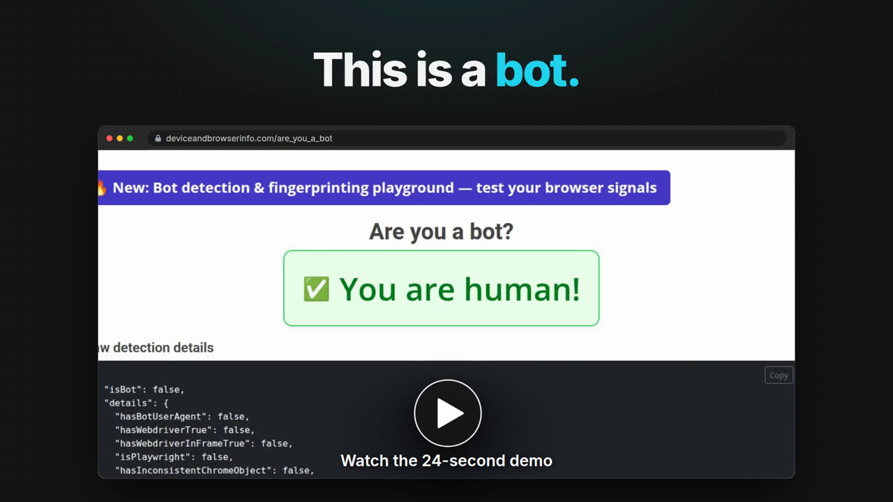

<p align="center">
  
</p>

<h1 align="center">WebSkrap</h1>

<p align="center">
  <strong>Async-first Python scraping on its own Chrome DevTools Protocol
  client, with persistent sessions, resource routing, stealth defaults, web
  search, a CLI, and an MCP server for agents.</strong>
</p>

<p align="center">
  <a href="https://pypi.org/project/webskrap/"></a>
  <a href="https://www.python.org/"></a>
  <a href="https://github.com/kacigaya/webskrap/blob/main/LICENSE"></a>
</p>

<p align="center">
  <a href="https://github.com/kacigaya/webskrap/blob/main/assets/demo.mp4"></a>
</p>

## Install

```bash
pip install webskrap
webskrap install
```

`webskrap install` downloads Chrome for Testing, which WebSkrap drives through
its own CDP client, with no Playwright. To upgrade from 2.x, read the
[migration guide](docs/migration-3.0.md).

## Quickstart

```python
import asyncio

from webskrap import WebSkrapClient


async def main() -> None:
    async with WebSkrapClient() as client:
        result = await client.fetch("https://example.com")
        print(result.status, result.title)
        print(result.text[:200])


asyncio.run(main())
```

Wait for deferred content with `ready_selector="#content"` in Python, CLI
`--ready-selector '#content'`, or the MCP fetch tools' `ready_selector`. The
element must become visible after the cookie notice is dismissed.

Ordinary HTTP errors return `ok=False`. For an empty error body, Chromium may
render its own error page: the text and HTML come from that page, while status,
headers and `final_url` come from the HTTP response.

## Challenge pages

Known challenge pages raise `blocked`: DataDome, Cloudflare, HUMAN, Akamai,
Fastly, AWS WAF, and reCAPTCHA or hCaptcha on a 403, 429 or 503 page. So do
DataDome, Cloudflare and Akamai block pages. WebSkrap waits for device checks
that reload the page, but never retries a refusal.

Four opt-in options answer one widget each. All are off by default:

| Python | CLI | Action |
| --- | --- | --- |
| `solve_cloudflare=True` | `--solve-cloudflare` | Clicks Cloudflare's Turnstile checkbox. |
| `solve_datadome=True` | `--solve-datadome` | Drags DataDome's slider onto its slot. |
| `solve_perimeterx=True` | `--solve-perimeterx` | Holds HUMAN's (PerimeterX) Press & Hold button. |
| `solve_recaptcha=True` | `--solve-recaptcha` | Clicks a reCAPTCHA v2 or hCaptcha checkbox on a 403, 429 or 503 page. |

WebSkrap reads the widget's position from its DOM and moves the cursor like a
person. It retries a few times, within 60 seconds of the widget appearing, on
top of `timeout_ms`. The call succeeds only when the real page loads with no
challenge on it. Otherwise it fails with `blocked`.

The provider still scores the browser and the exit IP, so a headless browser or
a flagged IP can still be refused. DataDome hard blocks, image and audio
puzzles, and reCAPTCHA v3 or invisible widgets stay `blocked`. WebSkrap reads,
copies and injects no token or cookie, and uses no outside solving service. The
[Stealth guide](https://kacigaya.github.io/webskrap/docs/user-guide/stealth/#challenge-solvers)
gives timings, retry counts and live-run results for each provider.

For a checkbox inside a form, fill the form, then call `browser_solve_captcha`
(CLI `webskrap browser solve-captcha`) before you submit. Its `captcha.state` is
`checked`, `challenge`, `gone`, `timeout` or `not_found`.

```bash
webskrap fetch https://example.com --virtual-display --solve-cloudflare
webskrap browser solve-captcha
```

Use these options only on sites whose terms and applicable law allow automated
access, and at a polite rate. Passing a challenge does not give permission to
collect data you may not collect.

For any other CAPTCHA, complete it by hand in a persistent headed browser:

```bash
webskrap browser open --headed --session manual --proxy http://localhost:8888 URL
```

Keep the same session, profile and proxy for later commands. On a remote host,
connect to its display with a remote desktop. `virtual_display=True` does not
give you one.

## Browser identity

Keep `profile_mode="native"` to show the browser's own identity. On Linux with
Xvfb, `virtual_display=True` runs a headed browser with no visible window. Full
profile emulation helps with device tests, but cannot replace every worker or
iframe value. See the [identity limits](src/webskrap/interfaces/guide.md).

## Python batches

`client.fetch_many(urls)` fetches a finite batch in order with one browser:

```python
async with WebSkrapClient() as client:
    results = await client.fetch_many(
        ["https://example.com", "https://example.org"], text_only=True
    )
```

Pages in a batch share cookies and storage. The browser closes after the batch.
Each batch and each `client.fetch()` call starts a fresh session, unless an
explicit `user_data_dir` shares state on disk. An empty batch launches no
browser. The first page error stops the batch and raises, with no partial list.
HTTP errors stay results with `ok=False`. With `screenshot=True`, each page gets
its own PNG filename.

For large inputs, per-page options, or state across batches, open a named
session with `session = await client.session("crawl")` and call
`await session.fetch(url)` per URL. Close it with
`await client.close_session("crawl")`, or let the client context close it.
Session names belong to one client, so give unrelated callers separate sessions.

## Select elements

Query fetched HTML with CSS selectors, or call `parse_html(html)` on HTML from
other sources.

```python
async with WebSkrapClient() as client:
    result = await client.fetch("https://example.com")
    print(result.css_first("h1").text)
    print([a.attrs["href"] for a in result.css("a[href]")])
```

## Search

Search loads the engine's results page in the same stealth browser and returns
the organic hits. WebSkrap unwraps click-tracking redirects, so each `url` is
the destination. Bing is the default. `engine="ddg"` uses DuckDuckGo's HTML
endpoint. Google is not offered.

```python
async with WebSkrapClient() as client:
    result = await client.search("example domain", max_results=5)
    for hit in result.hits:
        print(hit.title, hit.url)
```

```bash
webskrap search "example domain" --engine ddg --max-results 10 --format json
```

An engine that distrusts the exit address serves a bot challenge, which returns
a `blocked` error, not zero hits. Switch engine, reuse a persistent profile, or
change the exit IP.

## Visual browser interaction

Agents can see the rendered viewport and act by coordinates, which reaches
canvas and controls missing from the accessibility tree. MCP `browser_view`
returns a PNG directly. `browser_mouse` clicks, moves, scrolls or drags.
`browser_insert_text` types literal text into the focused control.

```bash
webskrap browser open https://example.com
webskrap browser view viewport.png --format json
# Open the returned PNG with your agent's image viewer, then choose coordinates.
webskrap browser mouse click 120 80
webskrap browser insert-text "hello"
webskrap browser press Enter
webskrap browser view viewport.png --format json
webskrap browser close
```

Coordinates are CSS pixels from the original image's top-left corner. Take a
fresh view after a scroll or page change. Headless Chromium needs no Xvfb for
this, but the agent's client and model must accept image input.

## Load only what the task needs

The default resource policy is `auto`: text-only fetches skip images, fonts and
media, while HTML fetches, screenshots and interactive pages load everything.
Override it with `resource_policy="all"`, `"lite"` or `"documents"`. Pick
`documents` only when the result survives without CSS.

Fetches wait for `domcontentloaded`. Add `ready_selector` for deferred content,
and use `networkidle`, screenshots and full snapshots only when the task needs
them. In a browser session, `browser_find(text="Save")` finds a known control
with its ancestors, and `browser_snapshot(target="e15", depth=2)` returns one
subtree. Add `boxes=true` only when geometry matters. Pass the returned refs to
`browser_interact`.

The CLI and MCP server reject cookies by default. Turn this off only for known
pages that do not need it. In Python, turn it on with
`SessionConfig(decline_cookies=True)`.

## Documentation

- [Agent skill](.agents/skills/webskrap/SKILL.md)
- [Quickstart](https://kacigaya.github.io/webskrap/docs/getting-started/quickstart/)
- [Python API](https://kacigaya.github.io/webskrap/docs/api-reference/)
- [CLI](https://kacigaya.github.io/webskrap/docs/user-guide/cli/)
- [MCP server](https://kacigaya.github.io/webskrap/docs/user-guide/mcp/)
- [Stealth](https://kacigaya.github.io/webskrap/docs/user-guide/stealth/)
- [Benchmarks](https://kacigaya.github.io/webskrap/docs/benchmarks/)
- [Development](https://kacigaya.github.io/webskrap/docs/development/)

The skill lives in `.agents/skills/webskrap/`. The `.claude/skills/webskrap/`
and `.codex/skills/webskrap/` folders are symbolic links to it, and each links
to the root `references/`. On Windows, enable Developer Mode and Git's
`core.symlinks` before you clone.

## Security

Persistent browser sessions keep Chromium's OS sandbox, store their profiles
`0700`, and confine MCP screenshot output to `./webskrap-output`. See
[SECURITY.md](SECURITY.md) for the security model and how to report a
vulnerability, and [CHANGELOG.md](CHANGELOG.md) for what changed.

## Contributing

See [CONTRIBUTING.md](CONTRIBUTING.md) for setup, checks, and pull request
expectations.

<!-- mcp-name: io.github.kacigaya/webskrap -->
